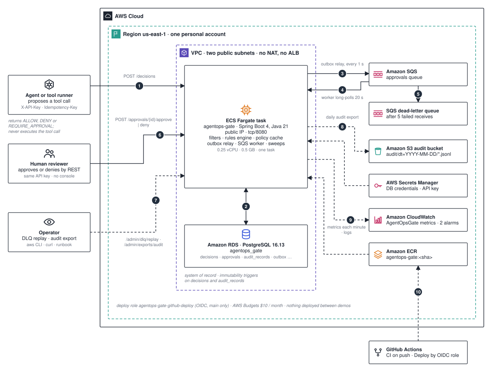

# Architecture

AgentOps Gate evaluates proposed AI tool calls against an ordered policy. It returns `ALLOW`, `DENY`, or `REQUIRE_APPROVAL`; it does not execute the tool call.

This page is the map: the parts, where they run, and the path one decision takes through them. The numbers on the diagram match the list below. The reasons behind the design are in the [ADRs](./adr/); the alarm procedures are in [`runbook.md`](./runbook.md); the recorded runs are under [`evidence/`](./evidence/).

## The path of one decision

1. **Agent → the gate.** `POST /decisions` arrives with `X-API-Key` and an `Idempotency-Key`. `ApiKeyFilter` and `IdempotencyKeyFilter` run first. `IdempotencyService` claims the key in `idempotency_records` together with a SHA-256 of the canonical body: the same key and body returns the stored response as 200, a different body returns 409. `DecisionService` loads the policy through `PolicyCache` (process memory, filled from `policies` and `rules` on a miss) and runs `RulesEngine`: rules sorted by `precedence`, first match wins, no match means `DENY`. The response is 201 with the `effect` and, when needed, an `approvalId`.
2. **Gate ↔ PostgreSQL.** One transaction writes the immutable `decisions` row and a `DECISION_CREATED` audit record. For `REQUIRE_APPROVAL` the same transaction also writes the `approvals` row (`PENDING`, `expires_at` thirty minutes out), an `APPROVAL_CREATED` audit record, and an `outbox_messages` row holding `ApprovalMessage{messageId, approvalId, decisionId, expiresAt}`. Either all of it commits or none of it does.
3. **Gate → Amazon SQS.** `OutboxRelay` runs every second, locks up to fifty unsent rows with `FOR UPDATE SKIP LOCKED`, publishes them, and records `sent_at` or `attempts` and `last_error`.
4. **Amazon SQS → the gate.** `ApprovalQueueWorker` long-polls for 20 s. For each message, one transaction inserts into `processed_messages` with `ON CONFLICT DO NOTHING` and runs `ApprovalService.process` (validate; expire if past the TTL; otherwise no-op), then the message is deleted. A redelivered message hits the conflict and counts in `gate.worker.duplicates`.
5. **Amazon SQS → dead-letter queue.** A message that fails five receives moves to the DLQ (visibility 60 s on AWS, 30 s on LocalStack). `DlqDepthAlarm` fires at one visible message.
6. **Reviewer → the gate.** `POST /approvals/{id}/approve` or `/deny` moves the approval and appends `APPROVAL_APPROVED` or `APPROVAL_DENIED`. `ApprovalExpiryWorker` runs every minute and appends `APPROVAL_EXPIRED` for approvals past their TTL. There is no console: reviewers use the same REST API and the same key.
7. **Operator → the gate.** `POST /admin/dlq/replay?limit=` (1 to 10) receives from the DLQ, sends back to the main queue, appends `DLQ_REPLAYED` once per message, and deletes from the DLQ. `POST /admin/exports/audit?date=` runs an export on demand.
8. **Gate → Amazon S3.** `AuditExportJob` (cron `0 5 0 * * *` UTC, previous day) writes `audit/dt=YYYY-MM-DD/YYYYMMDDT000000Z.jsonl` to the versioned audit bucket.
9. **Gate → Amazon CloudWatch.** Metrics in the `AgentOpsGate` namespace (`gate.decisions{effect}`, `gate.outbox.*`, `gate.worker.*`, `gate.http.responses{status_class}`, `http.server.requests`) are published each minute; the alarms are five or more 5xx responses in five minutes, and DLQ depth at one or more. The dashboard is `AgentOpsGate`.
10. **GitHub Actions → Amazon ECR.** `Deploy` runs only by manual dispatch from `main`. It assumes `agentops-gate-github-deploy` through OIDC (trust limited to `repo:Aly700/agentops-gate` on `main`), runs `./mvnw verify`, builds the image, pushes `agentops-gate:<sha>` and deploys the six application stacks; the OIDC stack is bootstrapped separately. ECS then pulls the new image.

## Components

| Component | Responsibility | Technology | Where to look |
| --- | --- | --- | --- |
| Agent or client | Proposes a tool call; retries with the same `Idempotency-Key` | any HTTP client, k6 | `load/decisions.js` |
| Human reviewer | Approves or denies through the REST API | curl | `web/ApprovalController.java` |
| Operator | Watches CloudWatch, replays the DLQ, runs exports | aws CLI, curl | [`runbook.md`](./runbook.md), `web/AdminController.java` |
| Gate service | API, filters, rules engine, policy cache, outbox relay, SQS worker, expiry sweep, export job, in one image | Java 21, Spring Boot 4.1, JPA, Flyway, AWS SDK v2 | `src/main/java/dev/affan/agentopsgate/{web,domain,rules,sqs,export,config}` |
| PostgreSQL | System of record: eight tables, triggers `decisions_are_immutable` and `audit_records_are_append_only` | RDS PostgreSQL 16.13 `db.t4g.micro`; `postgres:16-alpine` locally | `src/main/resources/db/migration/` |
| Approval queue and DLQ | Asynchronous approval work; poison isolation | SQS; LocalStack locally | `infra/lib/queue-stack.ts`, `localstack/init-aws.sh` |
| Audit bucket | Date-partitioned JSONL export | S3, versioned | `infra/lib/bucket-stack.ts` |
| Secrets | Database credentials and the API key as ECS secrets | Secrets Manager | `infra/lib/data-stack.ts` |
| Compute | One task, 0.25 vCPU / 0.5 GB, public IP, security group tcp/8080 | ECS Fargate, ECR | `infra/lib/service-stack.ts` |
| Observability | Namespace `AgentOpsGate`, two alarms, dashboard, logs | CloudWatch, Micrometer | `config/CloudWatchMetricsConfiguration.java` |
| Cost guard | $10 per month alarm | AWS Budgets | `infra/lib/budget-stack.ts` |
| CI/CD identity | Role `agentops-gate-github-deploy` | GitHub OIDC, IAM | `infra/lib/github-oidc-stack.ts` |

## Boundaries

- **Internet edge.** The task's public IP on tcp/8080, security group open to `0.0.0.0/0`. There is no ALB, WAF or TLS termination in the repository. One static `X-API-Key` is shared by agents, reviewers and operators; `/actuator/health` is open.
- **Network.** One personal account, `us-east-1`, one VPC with two availability zones, public `/24` subnets only, no NAT gateway. RDS sits in those subnets with `publiclyAccessible: false` and accepts 5432 only from the task's security group.
- **Task role.** Send and consume on the main queue, consume on the DLQ, `s3:PutObject` on `audit/*`, read of the API-key secret, `cloudwatch:PutMetricData` for the `AgentOpsGate` namespace only. Egress to ECR, Secrets Manager, SQS and S3 goes directly over the public IP.
- **Persistence.** PostgreSQL holds all state. S3 holds export copies. SQS is transport, not truth. `PolicyCache` is process memory, invalidated when a rule is added.
- **Local.** Compose runs the same image with PostgreSQL and LocalStack (`SPRING_PROFILES_ACTIVE=local`, static `test`/`test` credentials). Nothing is deployed between demos.

## What is proven, and where

| Claim | Evidence |
| --- | --- |
| `POST /decisions` is idempotent per key and body | `IdempotencyIntegrationTest` |
| Decision, approval, audit and outbox commit together; a killed task with unsent outbox rows loses nothing | `OutboxIntegrationTest`, [`evidence/chaos.md`](./evidence/chaos.md) |
| At-least-once delivery becomes one effect through `processed_messages` and a stable message id; DLQ replay has no second effect | `IdempotentConsumerIntegrationTest`, `SqsWorkerIntegrationTest`, `DlqReplayTest` |
| Five invariants hold under a seeded virtual clock and a fault bus (duplicate, reorder, delay, drop-then-redeliver, crash before and after commit); 200 seeds by default, 2,000 reported, `-Dsim.seed=<n>` reproduces one | `src/test/java/dev/affan/agentopsgate/sim/`, `target/sim-coverage.json` |
| The rules engine satisfies four properties over 1,000 trials each | `RulesEngineProperties` (jqwik) |
| Seventy-five Docker-backed tests run against real PostgreSQL and LocalStack | Testcontainers suites under `src/test/java` |

Not claimed: high availability (one task, no load balancer), authentication beyond the shared key, execution of the tool call, or more than one region.

## Facts the code relies on

- Tables: `policies`, `rules`, `decisions`, `approvals`, `audit_records`, `idempotency_records`, `outbox_messages`, `processed_messages`.
- Audit events: `POLICY_CREATED`, `RULE_CREATED`, `DECISION_CREATED`, `APPROVAL_CREATED`, `APPROVAL_APPROVED`, `APPROVAL_DENIED`, `APPROVAL_EXPIRED`, `DLQ_REPLAYED`.
- Ports 8080 (service), 5432 (PostgreSQL), 4566 (LocalStack). Database `agentops_gate`. Local queue names `agentops-gate-approvals` and `agentops-gate-approvals-dlq`, local bucket `agentops-gate-audit`; on AWS the names are generated by CDK and injected as `APPROVAL_QUEUE_URL`, `APPROVAL_DLQ_URL` and `AUDIT_BUCKET`.
- Timing knobs: `APPROVAL_TTL` (PT30M), `APPROVAL_EXPIRY_INTERVAL` (PT1M), `OUTBOX_RELAY_INTERVAL` (PT1S), `SQS_WAIT_TIME_SECONDS` (20), `IDEMPOTENCY_TTL`, `AUDIT_EXPORT_CRON`.
- CDK stacks: `AgentOpsGithubOidcStack`, `AgentOpsNetworkStack`, `AgentOpsDataStack`, `AgentOpsQueueStack`, `AgentOpsBucketStack`, `AgentOpsServiceStack`, `AgentOpsBudgetStack`.
